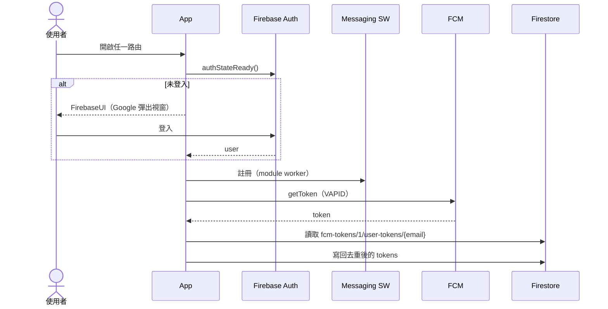
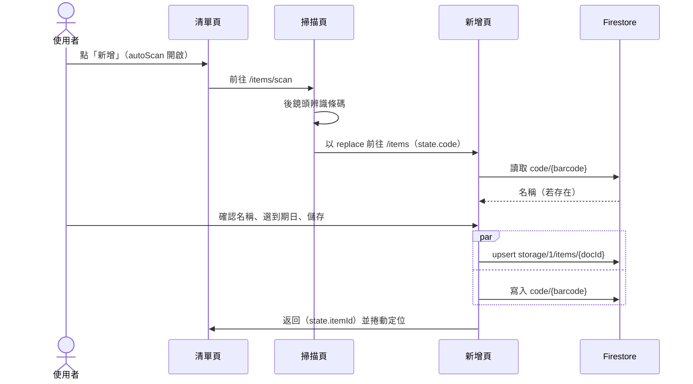
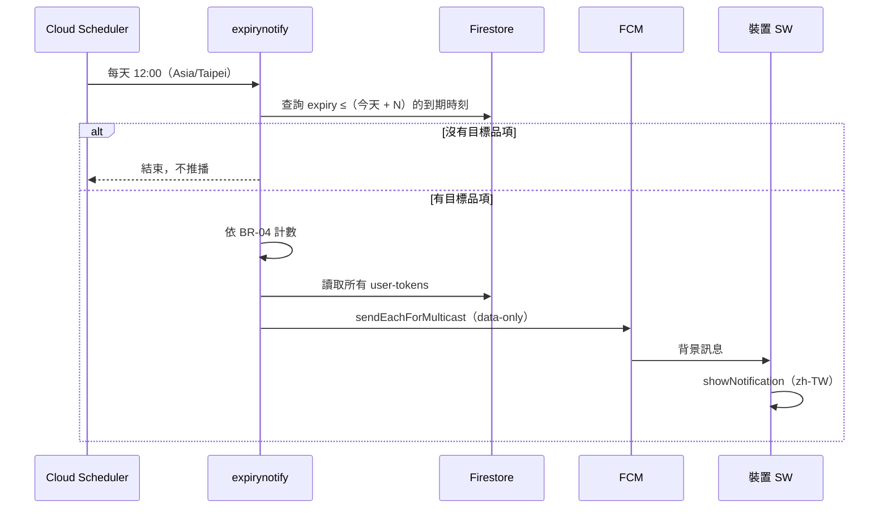

# Unicorn Storage — 規格書（SPEC）

家庭庫存／到期日追蹤 PWA：掃描零售條碼、登記到期日，在到期前收到推播提醒，減少浪費。

| 項目 | 內容 |
|---|---|
| 文件類型 | 活規格（living spec）：規格驅動開發（Spec-Driven Development）的唯一需求來源 |
| 版本 | 2.2 |
| 狀態 | 生效中：描述 `main` 的現況行為，並標出與規格不符之處 |
| 最後更新 | 2026-11-13 |
| 範圍 | Web App（`src/`）、排程函式 `expirynotify`（`functions/`）、Firestore 資料契約、Hosting 設定 |
| 相關文件 | `README.md`（專案介紹）、`CLAUDE.md`（開發注意事項）、`scripts/import/README.md`（匯入格式） |

---

## 0. 如何使用本文件

本文件是需求的唯一來源：行為以本文件為準，程式碼是它的實作，驗收準則（AC）是判定「完成」的依據。規格與程式不一致時，不默默修改任何一方：修正程式，或修改規格並寫下理由。

**變更流程**

1. **規格**：新增或修改需求，給定 ID、優先級與可驗證的 AC；還沒決定的部分寫進 §15，不先寫程式。
2. **計畫**：檢查受影響的資料模型（§7）、介面契約（§8）與護欄（§16.2）；重大取捨寫成 ADR（§14）。需要時可以由本文件衍生 `PLAN.md`／`TASKS.md`，但需求只記在這裡。
3. **實作**：commit 訊息引用需求 ID，例如 `fix(item): persist note (FR-ITEM-03)`。
4. **驗證**：依 §12 逐條驗收 AC。
5. **回寫**：更新需求狀態、追溯矩陣（§12.3）與變更紀錄（§17）；暫不修正的不一致登記在 §13。變更紀錄新增版本 `X.Y` 時，`package.json` 的 `version` 同步改為 `X.Y.0`（清單頁顯示的版本，FR-LIST-09）。

**編號**：ID 發布後不重複使用；廢止的需求標為「已廢止」，不刪除。

| 前綴 | 意義 | 前綴 | 意義 |
|---|---|---|---|
| `G`／`NG` | 目標／非目標 | `INV` | 資料不變量 |
| `C` | 限制條件 | `EC` | 例外與邊界情境 |
| `US` | 使用者故事 | `SEC` | 安全與隱私 |
| `FR-〈區域〉` | 功能需求 | `DEV` | 已知偏差（規格 ≠ 程式） |
| `BR` | 業務規則 | `ADR` | 設計決策紀錄 |
| `NFR` | 非功能需求 | `Q` | 待釐清問題 |
| `FUT`／`GR` | 擴充項目／擴充護欄 | | |

**需求句型（EARS）**

| 型態 | 句型 |
|---|---|
| 普遍 | 系統應〈回應〉。 |
| 事件驅動 | 當〈事件〉時，系統應〈回應〉。 |
| 狀態驅動 | 在〈狀態〉期間，系統應〈回應〉。 |
| 非預期行為 | 若〈異常條件〉，則系統應〈回應〉。 |
| 選用功能 | 在〈功能〉啟用時，系統應〈回應〉。 |

**AC** 寫成「前提或操作 → 預期結果」。**優先級**：`Must`（缺少即不可用）、`Should`（重要、可暫缺）、`Could`（加分）。**狀態**：`已實作`、`有偏差`（見 §13）、`未實作`。

---

## 1. 產品概述

### 1.1 問題

家中食品與日用品常因忘了到期日而過期浪費。靠記憶或紙本不會主動提醒；一般記事 App 又要手動輸入名稱與日期，流程太長，久了就不記了。

### 1.2 目標與成功指標

| ID | 目標 | 成功指標（建議值） | 可量測？ |
|---|---|---|---|
| G-1 | 用最少步驟登錄品項與到期日 | 已知條碼從點「新增」到儲存完成 ≤ 15 秒，且不需手動輸入名稱 | 是（手動計時） |
| G-2 | 到期前主動提醒 | 有目標品項的日子，12:00（Asia/Taipei）推播成功率（`successCount ÷ token 數`）≥ 95% | 是（函式日誌） |
| G-3 | 減少過期浪費 | 「過期後才被移除」的品項比例逐月下降 | 否：需要處置紀錄（FUT-07） |
| G-4 | 手機優先、可安裝 | 可從手機瀏覽器安裝為獨立視窗 App；主要操作單手可及 | 是（手動） |

### 1.3 非目標

- **NG-1** 公開註冊或多租戶服務：使用者僅限允許清單內的家庭成員。
- **NG-2** 購物清單、價格、食譜等延伸功能。
- **NG-3** 原生 App：以 PWA 交付。
- **NG-4** 即時多人同步：清單在載入與每次異動後重新讀取即可。
- **NG-5** 離線使用（見 FUT-08）。

### 1.4 限制條件

- **C-1** 平台為 Firebase：Hosting、Auth、Firestore、Cloud Functions v2（`asia-east1`）、Cloud Messaging；Cloud Functions 需要 Blaze 方案。
- **C-2** 只支援 Google 帳號登入。
- **C-3** 使用者在台灣：時區固定 Asia/Taipei，介面語言為繁體中文。
- **C-4** 前端為 React SPA（Vite 建置、MUI + Tailwind，見 ADR-003），沒有伺服器端渲染。
- **C-5** 條碼在瀏覽器端解碼（html5-qrcode），相機影像不離開裝置。
- **C-6** 管理腳本（`scripts/`）不在產品範圍內，但寫入的資料必須符合 §7。

---

## 2. 名詞定義

| 名詞 | 定義 |
|---|---|
| 品項（Item） | 一筆被追蹤的實體物品；同商品的不同批次是不同品項。 |
| 庫存（Warehouse） | 品項的容器；目前固定為單一共用庫存 `warehouseId = '1'`（ADR-004）。 |
| 到期日 | 使用者選的**日曆日**，一律以 Asia/Taipei 解讀。 |
| 到期時刻 `expiry` | 到期日當天 23:59:59.000（Asia/Taipei）的 epoch 毫秒，是到期日唯一的儲存形式（BR-01）。 |
| 今天 | 當下時刻在 Asia/Taipei 的日曆日。 |
| 剩餘天數 `d` | 到期日減今天的日曆日數；`d < 0` 表示已過期。 |
| 提醒窗口 `N` | 視為「即將到期」的最大天數，目前 `N = 7`（BR-03）。 |
| 條碼字典 | 條碼 → 商品名稱的對照表，讓再次掃到同商品時自動帶入名稱。 |
| 推播 token | FCM 發給「某裝置上的某瀏覽器」的識別碼，依使用者 email 歸檔。 |

---

## 3. 角色與使用者故事

- **家庭成員**：以允許清單內的 Google 帳號登入，管理共用庫存。
- **排程器**：Cloud Scheduler，每天觸發 `expirynotify`。
- **維運者**：用 Admin SDK 腳本檢查或匯入資料，不經過 App 的權限檢查。

| ID | 身為 | 我想要 | 以便 | 需求 |
|---|---|---|---|---|
| US-1 | 家庭成員 | 用 Google 帳號登入，且未授權的帳號看不到資料 | 家中庫存只有家人看得到 | FR-AUTH-01～03 |
| US-2 | 家庭成員 | 一眼看出哪些品項已過期或快到期 | 優先處理 | FR-LIST-01～04 |
| US-3 | 家庭成員 | 掃條碼就帶出名稱，只需選到期日 | 登錄又快又不會打錯 | FR-SCAN-01～05、FR-DICT-01～02 |
| US-4 | 家庭成員 | 修改、複製、刪除品項 | 清單反映實際庫存 | FR-ITEM-01～05、FR-LIST-05～07 |
| US-5 | 家庭成員 | 每天中午收到到期摘要 | 不用主動打開 App 也不會忘 | FR-NOTI-01～04 |
| US-6 | 家庭成員 | 把 App 安裝到手機主畫面 | 像原生 App 一樣使用，iOS 也能收推播 | FR-PWA-01～02 |

---

## 4. 功能需求

> AC 範例以「今天 = 2026-10-01（Asia/Taipei）」為準。

### 4.1 身分驗證與授權（AUTH）

**FR-AUTH-01 登入閘門**　`Must`｜`已實作`
- 在驗證狀態確定前，系統應只顯示載入指示。
- 當確認未登入時，系統應以 FirebaseUI 彈出視窗提供 Google 登入，且不渲染任何頁面內容。
- AC1：未登入時開啟任一路由（含深層連結）→ 只看到 Google 登入。
- AC2：登入成功 → 不需重新整理即顯示原本的路由。
- 實作：`src/App.jsx`

**FR-AUTH-02 未授權帳號**　`Must`｜`已實作`
- 若載入清單時 Firestore 回傳 `permission-denied`，則系統應提示「禁止〈email〉未授權的存取。」並登出。授權判斷由 Security Rules 執行（SEC-01）。
- AC1：以允許清單外的帳號登入 → 看到提示 → 回到登入畫面。
- 目前只有清單頁會偵測；其他頁面見 EC-08。
- 實作：`src/pages/List.jsx`

**FR-AUTH-03 推播 token 登錄**　`Must`｜`有偏差`（DEV-10、DEV-11）
- 當使用者已登入且瀏覽器支援 Service Worker 時，系統應註冊 messaging Service Worker、取得 FCM token，去重後加入 `fcm-tokens/1/user-tokens/{email}` 的 `tokens`。
- 若無法取得 token（未授權通知、瀏覽器不支援），則系統應讓其他功能照常運作；是否提示使用者依 Q-04 決定。
- AC1：同一裝置重複登入 → `tokens` 沒有重複值。
- AC2：同一帳號在兩台裝置登入 → `tokens` 有兩個值。
- AC3：拒絕通知權限 → 清單、編輯、掃描都照常可用。
- 實作：`src/App.jsx`、`src/services/firebase.js`

### 4.2 品項清單（LIST）

**FR-LIST-01 載入**　`Must`｜`有偏差`（DEV-12）
- 當清單頁開啟時，系統應讀取目前庫存的所有品項，載入期間顯示載入指示。
- 若庫存沒有品項，則系統應顯示「點選新增(+)按鈕開始建立清單」。
- 若因權限以外的原因讀取失敗，則系統應顯示錯誤並提供重試。
- 實作：`src/pages/List.jsx`

**FR-LIST-02 到期狀態**　`Must`｜`已實作`
- 系統應為每個品項顯示名稱、到期日（`yyyy/MM/dd`，Asia/Taipei）、狀態色點與狀態文字，分類依 BR-02。
- AC1：到期日 2026-10-01 → 紅色「今天過期」。
- AC2：2026-10-08 → 橘色「7天過期」；2026-10-09 → 綠色「8天過期」。
- AC3：2026-09-30 → 紅色「已過期」。
- 實作：`src/components/ItemCard/index.jsx`、`src/constants/status.js`

**FR-LIST-03 排序**　`Should`｜`已實作`
- 系統應提供六種排序：到期日升冪（預設）／降冪、名稱升冪／降冪、建立時間升冪／降冪。
- AC1：開啟清單 → 最早到期的品項在最上方。
- 排序選擇不跨工作階段保存；重新載入回到預設。
- 實作：`src/constants/sort.js`、`src/components/SortDialog/index.jsx`

**FR-LIST-04 搜尋**　`Should`｜`已實作`
- 當使用者輸入關鍵字時，系統應只顯示名稱包含該字串的品項（不分大小寫）；清除按鈕恢復完整清單。
- 當清單向下捲動超過 40 px 時，系統應收起搜尋列；向上捲動時再顯示。

**FR-LIST-05 複製**　`Should`｜`已實作`
- 當使用者向右滑觸發「複製」時，系統應建立欄位相同、但 `docId`、`created`、`updated` 為當下時刻的新品項，並提示「複製成功」1.5 秒。用途是同商品的另一批次：複製後再改到期日。
- AC1：複製後多一筆同名品項，原品項不變。

**FR-LIST-06 刪除**　`Must`｜`已實作`
- 當使用者向左滑觸發「刪除」時，系統應先詢問「確定刪除所選品項?」，確認後永久刪除並提示「刪除成功」1.5 秒。
- AC1：按「取消」→ 品項保留。
- AC2：按「刪除」→ 重新載入後品項消失。
- 刪除是硬刪除，不留紀錄（影響 FUT-07，見 GR-04）。

**FR-LIST-07 開啟與返回定位**　`Should`｜`已實作`
- 當使用者點選品項時，系統應開啟 `/items/{docId}`；滑動結束後 100 ms 內的點擊應忽略（桌面版滑動結束時會多觸發一次點擊）。
- 當使用者從編輯頁儲存或返回時，系統應把清單捲動到該品項並置中。

**FR-LIST-08 新增入口**　`Must`｜`已實作`
- 當使用者點「新增」時，系統應在這次點擊中請求通知權限（iOS 只允許在使用者手勢中請求），再依 `localStorage.autoScan` 開啟掃描頁或空白的新增頁。
- 若瀏覽器沒有 Notification API，則系統應略過請求並照常進入新增流程。

**FR-LIST-09 版本標示**　`Could`｜`已實作`
- 當清單頁開啟時，系統應在左上角顯示 `v{package.json version}` 3 秒，方便確認部署的版本。

### 4.3 新增與編輯（ITEM）

**FR-ITEM-01 表單**　`Must`｜`已實作`
- 系統應提供名稱（必填，錯誤訊息「名稱為必填」）、到期日（必填，zh-TW 日期選擇器）、備註（選填，多行）。
- 當品項帶有條碼（剛掃描，或既有品項已有條碼）時，系統應在名稱下方顯示「條碼: 〈code〉」。

**FR-ITEM-02 到期日限制**　`Must`｜`已實作`
- 系統應接受今天或之後的到期日，拒絕過去的日期；編輯時沿用原到期日（即使已過期）不受此限（BR-07）。
- AC1：新增品項、不改預設日期（今天）直接儲存 → 成功，清單顯示「今天過期」。
- AC2：嘗試選擇 2026-09-30 → 無法選取或顯示錯誤。
- AC3：編輯到期日為 2026-09-20 的品項，只改名稱或備註 → 儲存成功，到期日不變。
- AC4：把該品項的到期日改成 2026-09-21 → 無法選取或顯示錯誤；改成今天或之後 → 儲存成功。
- 實作：`src/pages/Item.jsx`（`toExpiry`、`isSelectableDate`）

**FR-ITEM-03 儲存**　`Must`｜`已實作`
- 當使用者按「儲存」且驗證通過時，系統應以 upsert 寫入品項：
  - 新品項：`docId` 與 `created` 取第一次按「儲存」的 epoch ms；失敗後重試沿用同一個值。
  - 既有品項：保留 `docId` 與 `created`。
  - `updated` 取當下；`expiry` 依 BR-01 換算；`code`、`note` 一併寫入。
- 當品項帶有條碼時，系統應同時更新條碼字典（FR-DICT-02）。
- 在寫入期間，系統應讓「儲存」按鈕顯示載入中（文案「儲存中」）並停用，忽略連點與 Enter 造成的再次送出；成功後維持停用直到離開頁面。
- 成功時提示「儲存成功」1.5 秒後回到清單（FR-LIST-07）。
- 若寫入失敗，則系統應顯示「儲存失敗」與看得懂的原因，恢復按鈕，並保留使用者輸入。
- 若寫入超過 10 秒（`SAVE_TIMEOUT_MS`）仍未完成，則系統應停止等待，視為失敗並提示「連線逾時，請確認網路後再試一次」。Firestore 無法取消已送出的寫入，逾時的寫入可能稍後才完成；因為重試沿用同一個 `docId`，晚到的寫入不會多出一筆品項（EC-16）。
- AC1：修改備註並儲存 → 重新開啟仍看得到新備註。
- AC2：編輯既有品項 → `created` 不變、`updated` 更新。
- AC3：新增品項時快速連點「儲存」→ 只產生一筆品項。
- AC4：以 DevTools 設為離線後按「儲存」→ 按鈕顯示「儲存中」；10 秒後顯示逾時，按鈕恢復、輸入保留；恢復連線後再按「儲存」→ 清單只有一筆該品項。
- 實作：`src/pages/Item.jsx`（`onSubmit`、`SAVE_TIMEOUT_MS`）、`src/utils/promise.js`（`withTimeout`）

**FR-ITEM-04 返回**　`Must`｜`已實作`
- 當使用者按返回時，系統應回到清單，不寫入任何資料。

**FR-ITEM-05 從表單掃描**　`Should`｜`有偏差`（DEV-16，待 Q-01）
- 系統應在表單提供掃描按鈕。現況：掃描成功後一律進入**新增**頁，而不是把條碼填回正在編輯的品項。

### 4.4 條碼掃描（SCAN）

**FR-SCAN-01 辨識**　`Must`｜`已實作`
- 在掃描頁開啟期間，系統應用後鏡頭持續辨識 EAN-13、EAN-8、Code 128、Code 39、Code 93，辨識頻率 45 fps（NFR-03）。
- 當辨識成功時，系統應暫停掃描並導向 `/items`（`replace`，掃描頁不留在上一頁紀錄），帶入 `state.code`。
- AC1：掃描已知商品 → 進入新增頁，名稱已帶入。
- AC2：掃描未知商品 → 進入新增頁，名稱空白、顯示條碼。
- 實作：`src/pages/Scan.jsx`、`src/hooks/useQrcodeScanner.js`

**FR-SCAN-02 釋放相機**　`Must`｜`已實作`
- 當使用者離開掃描頁時（包括掃描成功後的暫停狀態、相機仍在啟動中），系統應釋放相機。
- AC1：離開掃描頁後，系統的相機使用指示熄滅。

**FR-SCAN-03 相機權限被拒**　`Must`｜`已實作`
- 若同一工作階段中第一次遇到相機權限被拒，則系統應設定 `sessionStorage.cameraDenied` 並導向手動新增頁。
- 若同一工作階段中再次進入掃描頁仍被拒，則系統應顯示「相機權限已被拒絕」說明與「手動前往編輯頁面」按鈕，不再自動導向（避免迴圈）。

**FR-SCAN-04 自動掃描模式**　`Could`｜`已實作`
- 在勾選「自動進入掃描模式」期間（`localStorage.autoScan = 'true'`），系統應讓「新增」直接開啟掃描頁。

**FR-SCAN-05 離開掃描頁**　`Should`｜`未實作`
- 系統應在掃描頁提供返回與「手動輸入」入口。現況只有權限被拒的畫面有按鈕；相機因其他原因無法啟動時畫面空白（EC-03）。

### 4.5 條碼字典（DICT）

**FR-DICT-01 名稱帶入**　`Must`｜`已實作`
- 當新增頁帶有條碼時，系統應查詢 `code/{barcode}`；有資料時預填名稱，使用者仍可修改。

**FR-DICT-02 學習**　`Must`｜`已實作`
- 當帶條碼的品項儲存成功時，系統應把 `code/{barcode}` 設為 `{ id: barcode, name: 品項名稱 }`（最後寫入者為準，BR-05）。
- AC1：掃描新條碼並以「A」儲存 → 再掃同一條碼 → 名稱預填「A」。
- 實作：`src/services/item.js`

### 4.6 到期提醒（NOTI）

**FR-NOTI-01 排程**　`Must`｜`已實作`
- 系統應在每天 12:00（Asia/Taipei）於 `asia-east1` 執行 `expirynotify`。

**FR-NOTI-02 目標與計數**　`Must`｜`已實作`
- 當排程執行時，系統應找出所有 `d ≤ N` 的品項，並依 BR-04 計算「已到期」與「即將到期」的數量。
- 若沒有任何目標品項，則系統應不發送推播。
- AC1：只有一個 `d = 3` 的品項 → 推播「0個品項已到期」「1個品項即將到期」。
- AC2：所有品項都是 `d > 7` → 不發送。

**FR-NOTI-03 發送**　`Must`｜`有偏差`（DEV-09）
- 當有目標品項時，系統應以 data-only 訊息（§8.4）發送給所有已登錄的 token（所有使用者、所有裝置）。
- 若部分 token 發送失敗，則系統應照常送達其餘 token，並移除已失效的 token。
- 實作：`functions/index.js`

**FR-NOTI-04 呈現**　`Must`｜`有偏差`（DEV-08）
- 當裝置在背景收到訊息時，Service Worker 應顯示標題「Unicorn通知」，內文兩行：「〈expired〉個品項已到期」、「〈expiredSoon〉個品項即將到期」。
- 當使用者點擊通知時，系統應開啟 App 首頁。
- 在 App 位於前景期間，系統也應讓使用者看到摘要。
- 實作：`src/services/firebase-messaging-sw.js`

### 4.7 安裝與部署（PWA）

**FR-PWA-01 可安裝**　`Must`｜`已實作`
- 系統應提供 Web App Manifest（名稱「Unicorn Storage」、`display: standalone`、256／512 px 圖示）與 apple-touch-icon，可加入主畫面並以獨立視窗開啟。
- 實作：`public/manifest.json`、`index.html`

**FR-PWA-02 新版生效**　`Should`｜`已實作`
- 當新版部署後，系統應讓使用者下次載入根路徑 `/` 就拿到新版 HTML（`/` 回應 no-cache）。
- 實作：`firebase.json`

---

## 5. 業務規則

**BR-01 到期日的儲存形式**（ADR-001）
- 到期日 D 存為「D 當天 23:59:59.000（Asia/Taipei）」的 epoch 毫秒。
- 範例：2026-10-31 → `1793462399000`（= `2026-10-31T15:59:59Z`）。
- 存入與讀出都必須明確指定 Asia/Taipei，不得依賴裝置或伺服器時區（NFR-01）。

**BR-02 狀態分類**

| 狀態 | 條件 | 顏色 | 清單文字 |
|---|---|---|---|
| 已過期 | `d < 0` | 紅 `#FF0000` | 已過期 |
| 今天到期 | `d = 0` | 紅 `#FF0000` | 今天過期 |
| 即將到期 | `1 ≤ d ≤ N` | 橘 `#FF7700` | 〈d〉天過期 |
| 正常 | `d > N` | 綠 `#3DC40C` | 〈d〉天過期 |

**BR-03 提醒窗口**：`N = 7`。清單分類與推播計數必須使用同一個 `N`，調整時兩端一起改（GR-03）。

**BR-04 推播計數**
- 已到期 = `d ≤ 0`（含今天到期）；即將到期 = `1 ≤ d ≤ N`；`d > N` 不計入。
- 過期品項沒有下限：刪除之前每天都會計入「已到期」，作為清理提醒（是否調整見 Q-03）。

**BR-05 條碼字典**：最後寫入者為準，以帶條碼品項的最新名稱覆寫。字典是全域的，不屬於任何庫存（Q-05、Q-07）。

**BR-06 品項識別**
- `docId` 在建立時取 `Date.now()` 的十進位字串，之後不變；複製會產生新的 `docId`（ADR-005）。
- `created` 建立後不變；每次寫入都更新 `updated`。

**BR-07 到期日輸入**：到期日必須 ≥ 今天，以換算後的到期時刻判斷（`expiry ≥ 現在`）。例外：編輯時沿用原到期日（即使已過期）不重新檢查（Q-02 決議）。

**BR-08 搜尋與排序**：搜尋是名稱不分大小寫的子字串比對；名稱排序使用 `localeCompare`。

---

## 6. 非功能需求

| ID | 類別 | 需求 | 狀態 |
|---|---|---|---|
| NFR-01 | 時間正確性 | 所有到期運算以 Asia/Taipei 為準，結果不因裝置或伺服器時區而改變。 | 有偏差（DEV-15） |
| NFR-02 | 行動優先 | 寬度 360–430 px 可完整操作；主要操作（新增、排序）固定在右下角、單手可及。 | 已實作 |
| NFR-03 | 掃描效能 | 以 45 fps 嘗試解碼；光線充足時，已知商品 2 秒內辨識。 | 已實作 |
| NFR-04 | 準時 | 排程在每天 12:00（Asia/Taipei）觸發；送達延遲取決於 FCM 與裝置狀態，不另保證。 | 已實作 |
| NFR-05 | 規模假設 | 單一庫存 ≤ 1,000 個品項、≤ 10 位使用者、token 總數 ≤ 500（FCM 單次 multicast 上限）。超過時重新評估 ADR-007。 | 設計假設 |
| NFR-06 | 隱私 | 版本控制中不放個人庫存資料或服務帳戶金鑰；函式日誌只記錄數量，不記錄 token、email 或品項內容。 | 已實作 |
| NFR-07 | 在地化 | 介面與推播文案為繁體中文；日期顯示為 `yyyy/MM/dd`，選擇器使用 zh-TW 語系。 | 已實作 |
| NFR-08 | 平台 | 目標平台為 Android Chrome 與 iOS Safari；iOS 需加入主畫面（iOS 16.4 以上）才能收推播。 | 設計假設 |
| NFR-09 | 連線 | 需要網路；離線不在範圍內（FUT-08）。 | — |
| NFR-10 | 可維護性 | `yarn lint` 無錯誤；需求、程式與驗證的對應維持在 §12.3。 | 已實作 |

---

## 7. 資料模型（Firestore）

### 7.1 集合

| 路徑 | 內容 | 寫入者 | 讀取者 |
|---|---|---|---|
| `storage/{warehouseId}/items/{docId}` | 品項 | App、匯入腳本 | App、`expirynotify`、檢查腳本 |
| `code/{barcode}` | 條碼字典（全域） | App | App |
| `fcm-tokens/{groupId}/user-tokens/{email}` | 推播 token（`groupId` 目前固定為 `1`） | App | `expirynotify` |

### 7.2 品項 `Item`

| 欄位 | 型別 | 必要 | 說明 |
|---|---|---|---|
| `docId` | string | 是 | 與文件 ID 相同（INV-02） |
| `name` | string | 是 | 非空字串 |
| `expiry` | number | 是 | epoch ms，依 BR-01 |
| `created` | number | 是 | epoch ms，建立後不變 |
| `updated` | number | 是 | epoch ms |
| `code` | string | 否 | 條碼；App 手動建立時為 `''`，匯入資料可能沒有此欄位 |
| `note` | string | 否 | 備註（DEV-01：App 目前不會寫入） |

### 7.3 條碼字典 `BarcodeEntry`（文件 ID = 條碼）

| 欄位 | 型別 | 說明 |
|---|---|---|
| `id` | string | 條碼，與文件 ID 相同 |
| `name` | string | 最近一次儲存的品項名稱 |

### 7.4 推播 token `TokenRegistry`（文件 ID = 使用者 email）

| 欄位 | 型別 | 說明 |
|---|---|---|
| `tokens` | string[] | 該使用者所有裝置的 FCM token |

### 7.5 不變量

- **INV-01** `expiry` 換算回 Asia/Taipei 一定是 23:59:59.000，也就是 `(expiry ÷ 1000 + 28800) mod 86400 = 86399`。
- **INV-02** 品項的 `docId` 欄位等於文件 ID。
- **INV-03** `created ≤ updated`。
- **INV-04** `tokens` 沒有重複值。
- **INV-05** `code/{barcode}` 的 `id` 等於文件 ID。

### 7.6 查詢與索引

`expirynotify` 只做 `expiry ≤ X` 的單欄位範圍查詢，使用 Firestore 自動建立的單欄位索引，不需要複合索引。App 端的排序與搜尋都在瀏覽器中完成（ADR-007）。

---

## 8. 介面契約

### 8.1 路由

所有路由都在登入閘門（FR-AUTH-01）之後；Hosting 會把任何路徑改寫到 `/index.html`。

| 路徑 | 頁面 | 進入時的 `location.state` |
|---|---|---|
| `/` | 清單 | `itemId?`：返回後要捲動定位的品項 |
| `/items` | 新增 | `code?`：掃描得到的條碼 |
| `/items/:itemId` | 編輯 | — |
| `/items/scan` | 掃描 | — |

### 8.2 瀏覽器儲存

| 鍵 | 儲存區 | 值 | 用途 |
|---|---|---|---|
| `autoScan` | localStorage | `'true'`／`'false'` | FR-SCAN-04 |
| `cameraDenied` | sessionStorage | `'true'` | FR-SCAN-03 |

### 8.3 排程函式 `expirynotify`

| 項目 | 契約 |
|---|---|
| 觸發 | Cloud Scheduler `0 12 * * *`，時區 Asia/Taipei；區域 `asia-east1` |
| 讀取 | `storage/1/items` 中 `expiry ≤（今天 + N）的到期時刻` 的品項；`fcm-tokens/1/user-tokens` 全部文件 |
| 輸出 | 一次 `sendEachForMulticast`（§8.4） |
| 冪等性 | 無：重複執行會重複推播 |
| 重試 | 未設定 `retryConfig`（使用平台預設） |

### 8.4 FCM 訊息契約（v1）

```json
{
  "data": { "expired": "2", "expiredSoon": "3" },
  "tokens": ["<fcm-token>"]
}
```

- `data` 的值必須是字串（FCM 限制），內容是十進位非負整數。
- 只有 data、沒有 `notification` 區塊：畫面呈現完全由 Service Worker 負責（ADR-006）。
- 相容性：新增欄位必須能被舊版 Service Worker 忽略；不得更名或移除既有欄位（GR-05）。

### 8.5 Service Worker

- 以 Vite `?worker&url` 打包成 module worker（ADR-002），只負責推播：不快取、不攔截請求。
- 點擊通知時開啟 `https://unicorn-storage.web.app/`。

---

## 9. 關鍵流程

### 9.1 登入與推播登錄



### 9.2 掃描新增品項



### 9.3 每日到期提醒



---

## 10. 例外與邊界情境

| ID | 情境 | 預期行為 | 現況 |
|---|---|---|---|
| EC-01 | 相機權限被拒（該工作階段第一次） | 導向手動新增頁 | 符合 |
| EC-02 | 相機權限被拒（同一工作階段再次） | 顯示說明與手動按鈕 | 符合 |
| EC-03 | 沒有相機，或相機因權限以外的原因無法啟動 | 顯示錯誤並可手動新增 | 畫面空白，只能用系統返回（FR-SCAN-05） |
| EC-04 | 掃到字典裡沒有的條碼 | 新增頁名稱空白、顯示條碼 | 符合 |
| EC-05 | 通知權限被拒，或瀏覽器不支援推播 | 其他功能照常；依 Q-04 提示 | 功能照常，但錯誤未處理、沒有提示（DEV-11） |
| EC-06 | 瀏覽器沒有 Notification API（iOS Safari 分頁、部分 App 內瀏覽器） | 「新增」照常可用 | 符合 |
| EC-07 | 剛在「新增」按鈕授權通知 | token 立即登錄 | 下次開啟 App 才登錄（DEV-10） |
| EC-08 | 允許清單外的帳號 | 提示並登出 | 只有清單頁會偵測；其他頁面的權限錯誤沒有處理 |
| EC-09 | 讀取清單失敗（例如離線） | 顯示錯誤與重試 | 一直顯示載入中（DEV-12） |
| EC-10 | 寫入失敗 | 顯示看得懂的錯誤、保留輸入 | 符合 |
| EC-11 | 兩台裝置同時編輯同一品項 | 後寫入者整筆覆蓋 | 符合（已知取捨；做離線同步時再議，FUT-08） |
| EC-12 | token 失效（解除安裝、清除網站資料） | 發送失敗後移除 | 只記錄不移除（DEV-09） |
| EC-13 | token 超過 500 個 | 分批發送 | 整次發送失敗（DEV-09） |
| EC-14 | 裝置時區不是 UTC+8 | 日期與天數不受影響 | 可能差一天，編輯時可能改掉到期日（DEV-15） |
| EC-15 | App 在前景時收到推播 | 使用者看得到摘要 | 只寫入 console（DEV-08） |
| EC-16 | 儲存時離線或回應過慢 | 10 秒後提示逾時、保留輸入；逾時的寫入晚到時，重試不會產生重複品項 | 符合 |

---

## 11. 安全與隱私

- **SEC-01 授權邊界是 Firestore Security Rules。** Firebase web 設定與 VAPID 公鑰依設計公開在前端；只有允許清單內的帳號能讀寫 §7 的集合。規則目前不在版本控制中（DEV-06）。
- **SEC-02** 管理腳本以服務帳戶執行（`GOOGLE_APPLICATION_CREDENTIALS`），金鑰不得進入 repo。
- **SEC-03** `scripts/import/firestore_items.json` 是真實個人資料：已 gitignore 並自歷史清除，永遠不提交。
- **SEC-04** 函式日誌不得包含 token、email 或品項內容（NFR-06）。
- **SEC-05** 推播 token 以 email 為文件 ID，屬於個人資料；帳號移出允許清單時應一併刪除其 token 文件。`未實作`

---

## 12. 驗證

### 12.1 測試層級

目前沒有自動化測試。以下是建議的最小測試基礎，依投報率排序：

| 層級 | 工具 | 涵蓋 | 狀態 |
|---|---|---|---|
| 領域單元測試 | Vitest | BR-01～BR-04：到期時刻換算、`d` 計算、狀態分類、推播計數（固定時鐘、多時區） | 未實作；需先抽出共用模組（GR-03） |
| 安全規則測試 | Firebase Emulator + `@firebase/rules-unit-testing` | SEC-01：允許與拒絕帳號的讀寫 | 未實作；需先解決 DEV-06 |
| 函式測試 | `firebase-functions-test`（已在 `functions` 的 devDependencies）+ Emulator | FR-NOTI-01～03、BR-04 | 未實作 |
| 手動裝置驗收 | 實機：Android Chrome、iOS 主畫面版 | 相機、推播、安裝（§12.2） | 每次發版 |

### 12.2 發版前手動驗收

- [ ] 未登入時開啟深層連結 → 只看到登入（FR-AUTH-01）
- [ ] 掃描已知與未知條碼 → 名稱帶入／空白（FR-SCAN-01、FR-DICT-01）
- [ ] 離開掃描頁 → 相機指示熄滅（FR-SCAN-02）
- [ ] 同一工作階段拒絕相機兩次 → 第二次顯示說明頁（FR-SCAN-03）
- [ ] 新增今天到期的品項 → 清單顯示「今天過期」（FR-ITEM-02、FR-LIST-02）
- [ ] 編輯已過期品項、只改備註 → 儲存成功，到期日不變（FR-ITEM-02）
- [ ] 修改備註並重新開啟 → 備註仍在（FR-ITEM-03）
- [ ] 新增時連點「儲存」只產生一筆；離線儲存 10 秒後提示逾時（FR-ITEM-03）
- [ ] 複製；刪除（含取消）（FR-LIST-05、FR-LIST-06）
- [ ] 在 Cloud Scheduler 手動執行 `expirynotify` → 背景推播內容正確，點擊後開啟 App（FR-NOTI-01～04）

### 12.3 追溯矩陣

| 需求 | 實作 | 驗證 | 狀態 |
|---|---|---|---|
| FR-AUTH-01～02 | `src/App.jsx`、`src/pages/List.jsx` | 手動；規則測試（規劃） | 已實作 |
| FR-AUTH-03 | `src/App.jsx`、`src/services/firebase.js` | 手動 | 有偏差 |
| FR-LIST-01～09 | `src/pages/List.jsx`、`src/components/` | 手動 | 01 有偏差 |
| FR-ITEM-01～05 | `src/pages/Item.jsx`、`src/utils/promise.js` | 手動 | 05 有偏差 |
| FR-SCAN-01～05 | `src/pages/Scan.jsx`、`src/hooks/useQrcodeScanner.js` | 手動 | 05 未實作 |
| FR-DICT-01～02 | `src/pages/Item.jsx`、`src/services/item.js` | 手動 | 已實作 |
| FR-NOTI-01～04 | `functions/index.js`、`src/services/firebase-messaging-sw.js` | 手動；函式測試（規劃） | 03、04 有偏差 |
| FR-PWA-01～02 | `public/manifest.json`、`index.html`、`firebase.json` | 手動 | 已實作 |
| BR-01～04、NFR-01 | `src/pages/Item.jsx`、`src/components/ItemCard/index.jsx`、`functions/index.js` | 單元測試（規劃） | 有偏差（DEV-15） |
| BR-05～06 | `src/pages/Item.jsx`、`src/services/item.js` | 手動 | 已實作 |
| SEC-01 | Firestore Rules（不在 repo） | 規則測試（規劃） | 有偏差（DEV-06） |

---

## 13. 已知偏差（規格 ≠ 程式）

### 13.1 未解決

每一列都是待辦：修正程式讓它符合規格，或修改規格並寫下理由。「待實機確認」表示由程式碼推斷、尚未在裝置上重現。

| ID | 嚴重度 | 偏差 | 違反 | 建議修正 |
|---|---|---|---|---|
| DEV-06 | 中 | Firestore Security Rules 不在版本控制中，無法審查、測試或隨程式部署。線上規則以寫死的 2 個 email 作為允許清單，原樣提交會公開這些地址 | SEC-01 | 先把允許清單移到 Firestore（例如 `allowlist/{email}`），再把不含 email 的規則加入版控與 `firebase.json`，並以模擬器測試（§12.1）；部署前要先建立允許清單文件。2026-09-30 決定暫緩 |
| DEV-08 | 低 | App 在前景時收到推播只 `console.log`，使用者看不到 | FR-NOTI-04 | 前景時以 App 內提示或 `showNotification` 顯示 |
| DEV-09 | 低 | 發送失敗的 token 只記錄不移除；token 超過 500 個時 `sendEachForMulticast` 整次失敗 | FR-NOTI-03 | 移除回應為 `messaging/registration-token-not-registered`、`messaging/invalid-registration-token` 的 token；每 500 個分批 |
| DEV-10 | 低 | token 只在 App 載入時登錄；在「新增」按鈕授權通知後，要到下次開啟 App 才會登錄 | FR-AUTH-03 | 權限變成 granted 後立即登錄 |
| DEV-11 | 低 | `registerServiceWorker()` 沒有被 await，外層 `try/catch` 攔不到它的失敗，變成未處理的 Promise rejection；使用者也不知道自己收不到提醒 | FR-AUTH-03 | await 並處理錯誤；依 Q-04 提示 |
| DEV-12 | 低 | 讀取清單時，`permission-denied` 以外的錯誤被忽略，畫面一直停在載入中 | FR-LIST-01 | 顯示錯誤與重試按鈕 |
| DEV-13 | 低 | `expirynotify` 與 `scripts/` 寫死 `storage/1`、`fcm-tokens/1`，沒有經過 `getStoragePath()` | GR-01 | 集中路徑建構 |
| DEV-15 | 低 | 「今天」取自裝置本地日期，編輯頁也以裝置時區顯示到期時刻。非 UTC+8 的裝置在兩地日期不同的時段，剩餘天數會差一天；UTC+8 以東的裝置（如日本）編輯時日期會顯示成隔天，儲存後到期日延後一天 | NFR-01、BR-01 | 一律以 Asia/Taipei 計算「今天」，並用 `toZonedTime`／`formatInTimeZone` 在 Asia/Taipei 顯示 |
| DEV-16 | 待決 | 在編輯頁按掃描，成功後進入新增頁，而不是回填目前的品項 | FR-ITEM-05 | 依 Q-01 決議 |

### 13.2 已解決

| ID | 原偏差 | 解決方式 | 版本 |
|---|---|---|---|
| DEV-01 | 儲存時沒有寫入 `note`，編輯會清掉既有備註 | 寫入內容加上 `note` | 2.1 |
| DEV-02 | 掃描參數錯位，實際以函式庫預設的 2 fps 掃描 | 改為 `useQrCodeScanner('reader', onSuccess, undefined, { fps: 45 })`，並更正 hook 的 JSDoc 參數順序 | 2.1 |
| DEV-03 | 到期日驗證拒絕預設值與「今天」 | 改用換算後的到期時刻判斷（`expiry ≥ 現在`）；移除把 MUI 錯誤直接傳給 `setError` 的 `onError`，改由表單規則統一判斷 | 2.1 |
| DEV-04 | 沒有 Notification API 時，點「新增」沒有反應 | 先檢查 `'Notification' in window` | 2.1 |
| DEV-05 | 函式日誌含品項內容、email 與 token | 只記錄數量與錯誤代碼 | 2.1 |
| DEV-07 | 已過期品項無法只改名稱或備註 | 依 Q-02 決議：沿用原到期日不重新檢查；日期選擇器中，原日期以外的過去日期不可選 | 2.1 |
| DEV-14 | 寫入失敗的標題是「儲存失敗失敗」，內文直接顯示 `JSON.stringify(error)` | 標題改為「儲存失敗」；內文依錯誤顯示逾時、沒有權限，或「請稍後再試一次（錯誤代碼）」 | 2.2 |

---

## 14. 設計決策紀錄（ADR）

**ADR-001 到期日存為 Asia/Taipei 當天結束時刻的 epoch 毫秒**　`已採用`
- 背景：到期日是「一天」而不是「某個時刻」；使用者裝置與 Cloud Functions（UTC）的時區不同，存午夜或裝置本地時間，跨時區比較就會差一天。
- 決策：存 D 當天 23:59:59.000（Asia/Taipei）的 epoch 毫秒（BR-01）。
- 後果：「某時刻是否已過到期日」就是 `expiry ≤ 該時刻`，函式可以直接做範圍查詢；代價是每次換算都必須明確帶時區（NFR-01），舊資料需要遷移（`scripts/check/check.js` 以註解保留遷移程式）。

**ADR-002 Messaging Service Worker 以 Vite `?worker&url` 打包**　`已採用`
- 背景：SW 需要 import Firebase 模組；放在 `public/` 的靜態檔不會經過 Vite 打包。
- 決策：以 `import sw from './firebase-messaging-sw.js?worker&url'` 取得打包後的網址，並以 `type: 'module'` 註冊。
- 後果：SW 與 App 使用同一份相依版本，不可改回靜態檔。將來加入離線快取（FUT-08）時，要與這個 SW 合併或協調 scope。

**ADR-003 MUI v7 與 Tailwind v4 以 CSS cascade layers 共存**　`已採用`
- 決策：`StyledEngineProvider enableCssLayer` 搭配 `@layer theme, base, mui, components, utilities`。
- 後果：Tailwind utilities 穩定覆蓋 MUI 樣式，不需要 `!important` 或提高 specificity。

**ADR-004 單一共用庫存，路徑保留 `warehouseId`**　`已採用`
- 決策：現階段全家共用 `warehouseId = '1'`，但路徑維持 `storage/{warehouseId}/items`。
- 後果：多倉（FUT-01）只要改變 `warehouseId` 的來源與授權規則，不需要搬移資料；前提是遵守 GR-01。

**ADR-005 `docId` 使用 `Date.now()` 字串**　`已採用`
- 決策：客戶端以建立時刻產生 ID，同時作為 `created`。
- 後果：ID 可讀且天然依建立時間排序；家庭規模下同一毫秒碰撞的機率可以忽略。若改成多人高頻寫入，應改用 Firestore 自動 ID（`created` 保留）。

**ADR-006 推播使用 data-only 訊息，由 SW 組出文案**　`已採用`
- 決策：函式只送數量；標題與 zh-TW 內文由 SW 產生。
- 後果：改文案只需部署前端、不必重新部署函式；但 App 在前景時不會自動顯示（DEV-08），而且 SW 與函式之間形成契約（§8.4）。

**ADR-007 清單全量載入，在客戶端排序與搜尋**　`已採用`
- 決策：一次讀取整個庫存，在瀏覽器中排序與過濾。
- 後果：實作簡單、搜尋即時；在 NFR-05 的規模假設內成本可以忽略，超出時改為分頁或伺服器端查詢。

---

## 15. 待釐清問題

| ID | 問題 | 選項 | 影響 |
|---|---|---|---|
| Q-01 | 在編輯頁掃描，應把條碼填回目前的品項，還是開啟新品項？ | A 填回（建議）／B 維持開新品項 | FR-ITEM-05、DEV-16 |
| Q-02 | 已過期品項能否不改到期日，只修改名稱或備註？ | **已決議（2026-09-30）：A** 允許，只有到期日被修改時才檢查 ≥ 今天 | BR-07、FR-ITEM-02 |
| Q-03 | 推播的「已到期」是否要分出「今天到期」？過期很久的品項是否停止計入？ | A 維持 BR-04／B 三段計數／C 過期超過 M 天不計入 | BR-04、§8.4 |
| Q-04 | 通知權限被拒或不支援推播時，要不要在 App 內提示？ | A 一次性提示（建議）／B 常駐橫幅／C 不提示 | FR-AUTH-03、EC-05 |
| Q-05 | 條碼字典以「最後寫入」還是「第一次寫入」為準？要不要記錄修改者？ | A 最後寫入（現況）／B 第一次寫入，另提供手動修改 | BR-05、FUT-05 |
| Q-06 | 是否提供登出？登出時是否移除該裝置的 token？ | A 提供並移除（建議）／B 維持現況（無登出） | FR-AUTH-03、SEC-05 |
| Q-07 | 多倉之後，條碼字典是全域共用還是每個庫存各一份？ | A 全域（建議，即現況）／B 每倉一份 | FUT-01、FUT-05 |

---

## 16. 演進路線與擴充護欄

### 16.1 擴充項目（未排程）

初期不實作，但現在的設計不能擋住它們。

| ID | 擴充 | 資料模型預留 | 前置條件 |
|---|---|---|---|
| FUT-01 | 多倉／多群組、家庭共享 | `warehouseId` 已在路徑中；新增 `warehouses/{id}`（成員 email 清單），token 依成員歸屬 | GR-01；授權規則改為依成員判斷 |
| FUT-02 | 分類與標籤 | 選填 `category: string`、`tags: string[]` | GR-02；篩選 UI |
| FUT-03 | 數量與單位、低量提醒 | 選填 `quantity: number`、`unit: string`、`minQuantity: number` | GR-02；「用掉一個」的互動 |
| FUT-04 | 通知彈性（提前天數、時間、免打擾） | 使用者設定文件 | GR-03、GR-06；函式改為依使用者分組發送 |
| FUT-05 | 條碼字典共享、串接外部商品資料庫 | `code/{barcode}` 加上選填的 `source`、`updatedBy`、`updatedAt` | Q-05、Q-07 |
| FUT-06 | 匯入／匯出 | 沿用 `scripts/import/README.md` 的 JSON 格式 | App 內匯出（JSON／CSV） |
| FUT-07 | 統計與回顧（過期率、常買品項） | 以處置紀錄取代硬刪除：`disposedAt`、`disposition: 'used' \| 'discarded'` | GR-04；G-3 的量測依賴此項 |
| FUT-08 | 離線與同步 | Firestore 本地快取 + App shell 快取 | 與 ADR-002 的 SW 協調；衝突策略（EC-11） |

### 16.2 護欄（現在就要遵守）

- **GR-01** 所有 Firestore 路徑都經由單一 helper 以 `warehouseId` 組成，包括函式與腳本；不得新增寫死的 `'1'`（現況見 DEV-13）。
- **GR-02** 新欄位一律選填，讀取端必須能處理缺值；需要回填舊資料時，在 `scripts/` 提供遷移腳本並更新 §7。
- **GR-03** 到期時刻換算、`d` 的計算、狀態分類與 `N` 集中在一個共用的領域模組；客戶端與函式共用，或各自一份但跑同一組測試。
- **GR-04** 在統計（FUT-07）上線前，不再增加依賴「刪除即消失」的行為。
- **GR-05** §8.4 的 data 契約只能向後相容地擴充。
- **GR-06** 通知時間（12:00）與提醒窗口（`N`）不得再增加寫死的位置。

---

## 17. 變更紀錄

| 版本 | 日期 | 變更 |
|---|---|---|
| 2.2 | 2026-11-13 | FR-ITEM-03 新增儲存中狀態、防止重複送出與 10 秒逾時（AC3、AC4、EC-16）；修正 DEV-14；§0 規定 `package.json` 版本跟隨規格版本（`0.1.0` → `2.2.0`） |
| 2.1 | 2026-09-30 | 修正 DEV-01、02、03、04、05、07；Q-02 決議採 A，更新 BR-07 與 FR-ITEM-02；§13 拆成未解決／已解決 |
| 2.0 | 2026-09-30 | 改寫為規格驅動格式：編號需求與 EARS 驗收準則、業務規則、資料與介面契約、流程圖、驗證與追溯、已知偏差、ADR、擴充護欄 |
| 1.0 | — | 初版概要：目標、使用者流程、頁面、資料模型、到期通知、技術方向、擴充方向 |
